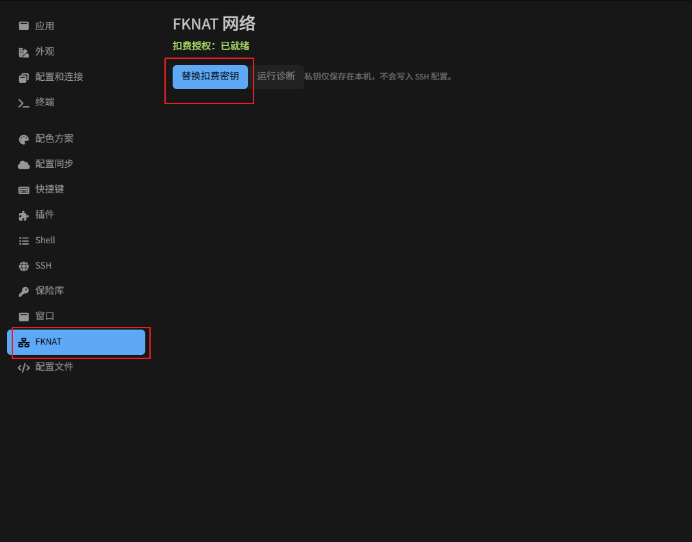
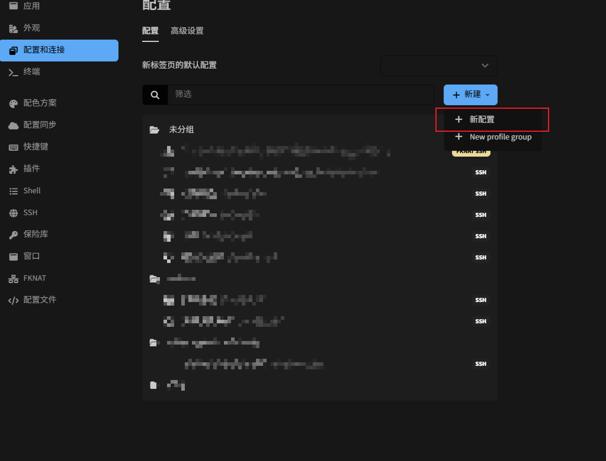
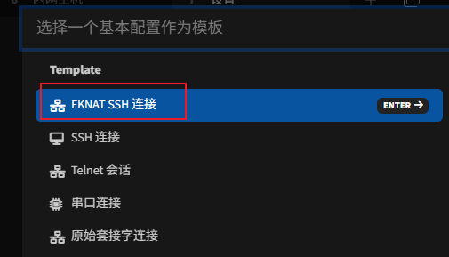
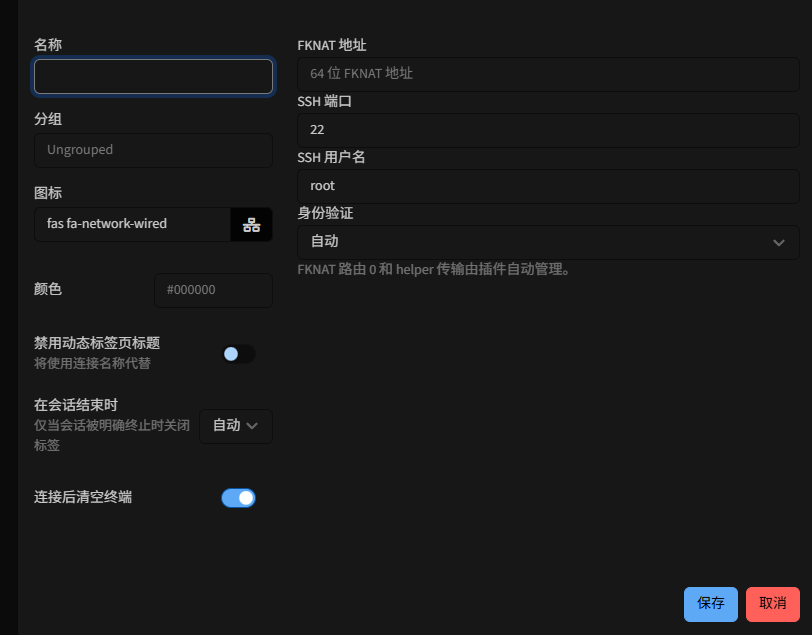

# Tabby FKNAT SSH

通过 FKNAT 在 Tabby 中连接远程 SSH 主机。插件提供 FKNAT 地址和凭证配置，SSH 登录、
主机密钥校验、终端、SFTP 和端口转发继续使用 Tabby 的原生 SSH 功能。界面支持英文、
简体中文和繁体中文，并跟随 Tabby 的语言设置。

- SSH 端程序：[wangshiben/fknat-ssh](https://github.com/wangshiben/fknat-ssh)
- 凭证申请：[https://ca.fknat.top/](https://ca.fknat.top/)
- npm 插件包：[tabby-fknat](https://www.npmjs.com/package/tabby-fknat)

## 1. 准备 SSH 端和 FKNAT 凭证

需要准备两端：**被连接的 SSH 主机**运行 `fknat-ssh`，**发起连接的电脑**安装 Tabby
和本插件。仅安装 Tabby 插件还不能发布远程主机的 SSH 服务。

1. 在 [凭证申请网站](https://ca.fknat.top/) 按页面提示申请并下载 FKNAT 扣费授权
   JSON 凭证。SSH 端的部署和 Tabby 端的凭证导入均需要准备有效的凭证文件。
2. 确认被连接主机已经安装并启动 SSH 服务，且准备好了可登录的 SSH 用户和密码或密钥。
3. 在该主机上按 [fknat-ssh 项目说明](https://github.com/wangshiben/fknat-ssh)
   获取或构建程序，并安装、运行 `fknat-ssh`，将本机 SSH 服务发布到 FKNAT。

下面是 Linux + systemd 的示例。先将 `fknat-ssh` 放入可执行命令路径，并把
`/secure/billing-key.json` 替换为该主机上的实际凭证路径：

```bash
sudo fknat-ssh install --billing-key /secure/billing-key.json
sudo fknat-ssh address
sudo fknat-ssh status
sudo fknat-ssh doctor
```

`install` 会安装并启动 systemd 服务，默认 SSH 后端为 `127.0.0.1:22`。如果 SSH 服务
使用其他端口，在安装命令中追加相应参数，例如 `--ssh-target 127.0.0.1:2222`。
其他运行方式和平台支持情况请参阅 `fknat-ssh` 项目说明。

记录 `fknat-ssh address` 输出的 **64 位十六进制 FKNAT 地址**，稍后填入 Tabby。
连接期间需要保持 SSH 服务和 `fknat-ssh` 运行。

FKNAT JSON 凭证用于网络准入和扣费授权；SSH 用户名、密码和 SSH 私钥用于远程主机登录。
两者需要分别配置。

## 2. 安装 Tabby 插件

支持 Windows、Linux、macOS 的 x64 和 arm64 平台。发布包已内置各平台所需的 helper，
Tabby 端无需另行编译它。

### 通过插件市场安装

1. 打开 Tabby 的 **设置 → 插件 → 可用**。
2. 搜索小写 **`fknat`**，找到对应插件并点击安装（英文界面为 **Get**）。
3. 使用 **0.1.3 或更新版本**，安装完成后重启 Tabby。

已经安装的插件会出现在 **已安装** 列表中，此时请在该列表中搜索 `fknat`。

### 在插件目录中使用 npm 安装

如已安装 Node.js / npm，也可以打开 Tabby 的实际插件目录，在该目录中执行：

```bash
npm install tabby-fknat@latest --registry=https://registry.npmjs.org/
```

Windows 默认安装路径的 PowerShell 示例：

```powershell
Set-Location "$env:APPDATA\tabby\plugins"
npm install tabby-fknat@latest --registry=https://registry.npmjs.org/
```

其他系统或便携版请通过 Tabby 的插件设置打开实际插件目录，再运行安装命令。
安装完成后重启 Tabby，设置侧栏应出现 **FKNAT**。

## 3. 导入 FKNAT 凭证

1. 打开 **设置 → FKNAT**。
2. 点击 **导入扣费密钥**，选择从 [凭证申请网站](https://ca.fknat.top/) 下载的
   JSON 凭证文件。已导入时，按钮显示为 **替换扣费密钥**。
3. 页面显示 **扣费授权：已就绪** 后，可以点击 **运行诊断** 检查凭证和网络状态。
   目标 SSH 服务是否可登录，还需要通过后面的实际连接确认。

下图展示已导入凭证的状态，红框标出了 FKNAT 设置入口和凭证按钮：



凭证保存在本机的插件数据目录中，不会写入 SSH 连接配置。此处导入的是 FKNAT JSON
凭证，SSH 登录私钥在连接的身份验证选项中配置。

## 4. 新建 FKNAT SSH 连接

### 打开新建配置

进入 **设置 → 配置和连接**，点击 **新建 → 新配置**：



### 选择 FKNAT 模板

在基本配置模板中选择 **FKNAT SSH 连接**：



### 填写连接参数并保存

| 字段 | 填写方式 |
| --- | --- |
| 名称 | 用于在 Tabby 中识别连接的名称，可自行填写。 |
| FKNAT 地址 | SSH 端执行 `fknat-ssh address` 获得的完整 64 位十六进制地址。 |
| SSH 端口 | 默认 `22`；实际转发的 SSH 后端由 SSH 端的 `--ssh-target` 配置决定。 |
| SSH 用户名 | 远程 SSH 主机上实际存在且允许登录的用户，例如 `root` 或 `ubuntu`。 |
| 身份验证 | 按远程 SSH 服务允许的方式选择自动、密码、公钥、SSH Agent 或键盘交互。 |
| 私钥 | 选择公钥认证时，填写本机 SSH 私钥文件的实际路径。 |



密码认证会在连接时由 Tabby 提示输入 SSH 密码。公钥认证需要远程主机已授权对应公钥；
SSH Agent 认证需要本机已启动 Agent 并加载对应密钥。选择适合该主机的方式后点击 **保存**。

## 5. 连接和使用

1. 从 Tabby 的连接列表打开刚保存的 FKNAT SSH 配置。
2. 首次连接时，核对远程主机的 SSH 主机密钥指纹，并按 Tabby 提示确认。
3. 根据所选认证方式输入密码或使用私钥登录；成功后即可使用远程终端。
4. SFTP、端口转发等操作继续使用 Tabby 原生 SSH 功能。

也可以在快速连接中输入以下格式，替换其中的用户名和地址：

```text
fknat://用户名@64位FKNAT地址
```

快速连接使用默认 SSH 参数；需要指定认证方式或私钥时，建议先保存一个 FKNAT SSH 配置。

## 常见问题与日志

### 市场安装显示 `[object Object]`

`0.1.2` 及更早版本的依赖声明可能让市场安装器额外下载 Tabby 内置插件，并在
`tabby-ssh` 的 `postinstall` 阶段失败。请安装 `0.1.3` 或更新版本。

### 出现 Agent 提示或认证被拒绝

`Agent auth selected, but no running Agent process is found` 表示本机未找到 SSH Agent。
自动认证模式也可能出现这个提示，需要结合后续日志判断。使用 SSH 私钥时，可以选择
**公钥** 并指定私钥路径；只有已经启动 Agent 且加载密钥时才选择 **SSH Agent**。

`Authentication rejected` 时，检查 SSH 用户名、密码或私钥是否正确，以及远程主机是否
允许对应的用户和认证方式。FKNAT 凭证就绪并不代表 SSH 登录认证已经通过。

### 连接超时或 SSH 端不可用

先在 SSH 端检查 `fknat-ssh status` 和 `fknat-ssh doctor`，确认程序、SSH 服务及凭证
状态正常。Tabby 设置中的 **运行诊断** 用于检查发起连接这一端的凭证和网络状态。

helper 日志会记录身份准备、客户端准入、Relay 选择、Noise 握手、路由打开和 SSH
字节流桥接等阶段。若 Noise 握手后在 `stage=dial_route` 超时，优先检查 SSH 端的路由
`0` 和计费数据面状态。

### 日志位置

Windows 默认路径如下：

| 日志 | 路径 | 内容 |
| --- | --- | --- |
| Tabby 日志 | `%APPDATA%\tabby\log.txt` | 插件加载版本、加载目录、认证方式、helper 调用和 SSH 连接信息。 |
| helper 日志 | `%APPDATA%\tabby-fknat\logs\helper.log` | FKNAT 准入、路由和传输阶段。 |
| 主进程异常 | `%APPDATA%\tabby\main-process-errors.log` | Tabby 自身的主进程异常，文件可能不存在。 |

Linux 和 macOS 的 helper 日志位于下表所列数据目录的 `logs/helper.log`。
helper 日志每次启动时追加，达到 10 MiB 后会在下一次启动时压缩归档，最多保留 10 个
压缩归档。即使父进程未提供可用的 stderr，文件日志仍会独立写入。

如果普通 SSH 和 FKNAT 连接都无法保存，请检查 Tabby 的 `config.yaml` 是否可写。
Windows 默认路径为 `%APPDATA%\tabby\config.yaml`；解除只读后，在当前窗口重新保存配置。

## 数据存储和实现说明

| 系统 | 插件数据目录 |
| --- | --- |
| Windows | `%APPDATA%\tabby-fknat` |
| Linux | `~/.config/tabby-fknat`（设置了 `XDG_CONFIG_HOME` 时位于该目录下） |
| macOS | `~/Library/Application Support/tabby-fknat` |

导入的 JSON 保存为数据目录中的 `secrets/billing.json`，helper 在同一目录中创建并
复用 `client.identity`。扣费 JSON 的内容不会写入 Tabby 配置或日志。

插件通过 Tabby 已注册的原生 SSH 配置提供器打开连接，使密钥自动发现、认证和 SFTP
使用同一份 SSH 模块。生成的 ProxyCommand 显式传入 `--config-dir`；FKNAT 地址作为 SSH
主机密钥身份，传输使用逻辑路由 `0`。helper 的 stdout 专用于原始 SSH 字节流，诊断
信息写入 stderr 和日志文件。

helper 使用生产环境准入和自动发现，CA 请求使用 `https://ca.fknat.top`，并按当前
部署要求跳过证书校验。

## 开发与发布

### 本地开发

```sh
npm install --legacy-peer-deps
npm run typecheck
npm test
npm run build
cd helper && go test ./...
```

生成六个平台的辅助程序和 `bin/manifest.json`：

```sh
npm run build:helper
```

helper 的基础检查示例：

```sh
bin/linux-x64/fknat-tabby-helper version --json
bin/linux-x64/fknat-tabby-helper doctor
```

`doctor` 需要有效的本地扣费凭证。添加 `--server-id ADDRESS` 后，可以在不启动 SSH
登录认证的情况下检查目标的路由 `0`。

helper 当前使用 GitHub 上的 `fknat` 提交 `7fd6611582bb`，对应的 Go 模块版本为
`v0.0.3-0.20261024081955-7fd6611582bb`。该提交已修正上游依赖声明，helper 的 `go.mod`
无需再替换 QuicFrameWork 的占位版本。`natP2pSDK` 当前已发布的版本仍为 `v0.0.2`，
因此保留下述 Windows 兼容补丁。更新依赖时使用 `go get`，并将结果锁定在 `go.mod`
和 `go.sum` 中；`fknat@latest` 当前仍指向较早的版本标签，不能代替这个主分支提交。

### 发布包验证

Tabby 自带 Angular、RxJS 和各个原生插件。它们声明为 optional peer dependencies，
让插件使用宿主提供的模块，避免市场安装器另行下载 npm 上的 Tabby 内置插件。

`npm pack` 会运行 TypeScript 验证，并重新构建全部六个 helper 目标。发布包包含
`dist/`、`bin/`、README 和本说明使用的 `docs/images/` 截图。
`bin/manifest.json` 记录各 helper 的 SHA-256，插件在启动前进行校验。

Windows 打包可能不保留 Unix 执行权限。Linux/macOS 首次启动时，插件会在校验通过后
补上内置 helper 的当前用户执行权限；自定义 helper 仍需自行设置执行权限。

打包后验证真实归档的默认 npm 安装，文件名应对应本次发布的版本：

```sh
npm pack
npm run verify:package -- tabby-fknat-0.1.4.tgz
```

此检查在空目录中安装发布包，保留生命周期脚本和默认 peer 解析，确认未下载第二份
Tabby/Angular，并验证六个平台的 helper 校验和。不能用开发时的 `--legacy-peer-deps`
或 `--ignore-scripts` 代替这项发布检查。

原生发布构建固定使用 Go 1.25，通过 `proxy.golang.com.cn` 下载模块，禁用 VCS 直连，
设置 `GOWORK=off` 并启用 `-mod=readonly`，避免发布时回退到本地工作区或静默改写模块元数据。

`natP2pSDK v0.0.2` 的扣费私钥读取误把 Unix `0600` 权限要求用于 Windows。发布构建
复制该已发布模块至临时目录，应用范围受限的 Windows 兼容补丁，通过临时 modfile
引用副本并执行权限回归测试。Unix 的权限检查继续保留，构建结束后清理临时副本，
不修改模块缓存或 helper 的模块元数据，也不依赖本地 SDK 工作区。升级 SDK 版本时
必须重新审查补丁。

每次发布需递增版本号。`0.1.1` 包含原生 SSH 提供器、Windows 权限兼容和独立文件日志
修复；`0.1.2` 增加内置 helper 的 Unix 执行权限恢复；`0.1.3` 修复市场安装问题；
`0.1.4` 更新 GitHub 上的 FKNAT 依赖，并补充安装、配置和使用截图。
不要重新安装旧的 `tabby-fknat-0.1.0.tgz`，以免覆盖这些修复。
